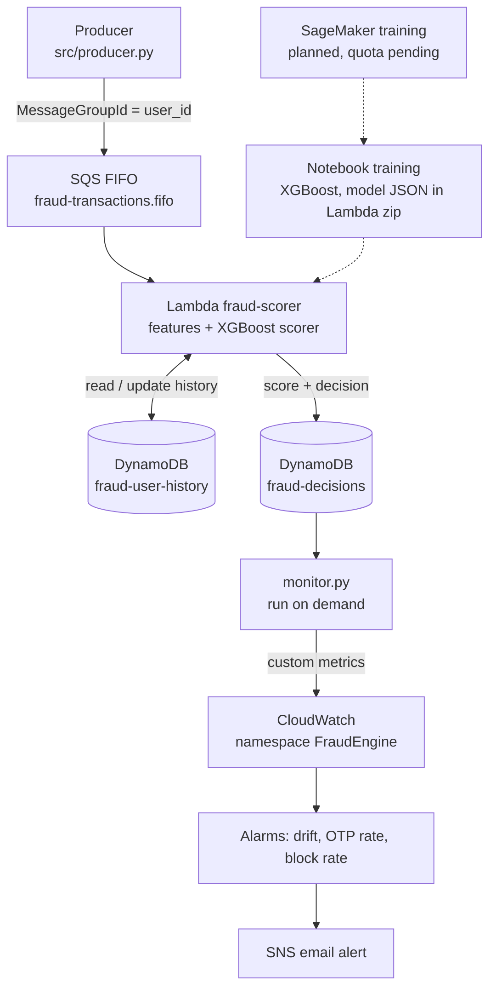

# Real-Time Fraud Detection & Risk Engine

ML + streaming + AWS. Each transaction is scored as it arrives, a decision is made, and monitoring catches model drift.

Flow: Producer -> SQS FIFO -> Lambda (features + XGBoost) -> DynamoDB -> CloudWatch metrics -> Alarms -> SNS alert

## Architecture



## Results (synthetic data, time-based split)
- Baseline (raw features): PR-AUC 0.135
- Feature engineering added (user history, velocity): PR-AUC 0.482
- AWS replay, last 10k transactions: PR-AUC 0.481, recall 80% (32/40 fraud), precision 8.3%
- BLOCK tier only: precision 57%, recall 42%
- Lambda scoring latency (warm, per transaction, inside Lambda): p50 about 20 ms, p95 about 24 ms. Details in DESIGN_DISCUSSION.md
- Offline vs AWS score parity: max diff 5e-07

## Decision policy
score > 0.98 BLOCK, score > 0.5 OTP_CHALLENGE, else APPROVE.
Thresholds chosen from cost analysis (missed fraud 100x costlier than a false alarm, assumed costs).

## Monitoring
CloudWatch namespace FraudEngine: BlockRate, OtpRate, MeanRiskScore, ScorePSI, Precision, Recall.
Drift demo (4x amounts, more new devices): PSI 0.014 -> 1.03, OTP rate 3.6% -> 12.2%, drift + OTP alarms fired.

## Design decisions
- FIFO queue grouped by user_id keeps one user's transactions in order (needed for velocity features).
- Idempotent writes (conditional put) so duplicate deliveries are skipped.
- XGBoost model JSON evaluated by a small dependency-free scorer inside Lambda, verified by a parity test.
- Features use only past data, same code path in training and serving.

## Honest limitations
- Data is synthetic. Fraud rate is 0.54%, and the evaluation window has only 40 frauds, so precision/recall are noisy.
- Kinesis was blocked by the organization policy (SCP) on my account, so I used SQS FIFO. Kinesis would suit higher throughput and replay.
- SageMaker is not used yet. Creating a training job failed with ResourceLimitExceeded (ml.m5.large training quota is 0 on this new account). A quota increase to 1 was requested (requested 2026-11-26; status CASE_OPENED, awaiting AWS Support). The endpoint quota is 8, so hosting is possible once a SageMaker-trained model exists. src/sm_train.py is written but not yet run end to end. Kafka is not used; ingestion uses SQS FIFO.
- Precision/Recall need fraud labels, which arrive late in real life, so rate/drift alarms come first.

## Run

```bash
pip install -r requirements.txt
python src/generate_data.py      # creates data/transactions.csv
# train in notebooks/01_eda.ipynb (saves models/)
python src/producer.py 30000     # send transactions to SQS
python src/evaluate.py           # precision and recall from DynamoDB
python src/monitor.py            # publish CloudWatch metrics
```

Needs an AWS login (`aws login --region ap-southeast-2`) and the resources above. `teardown.sh` removes them.
